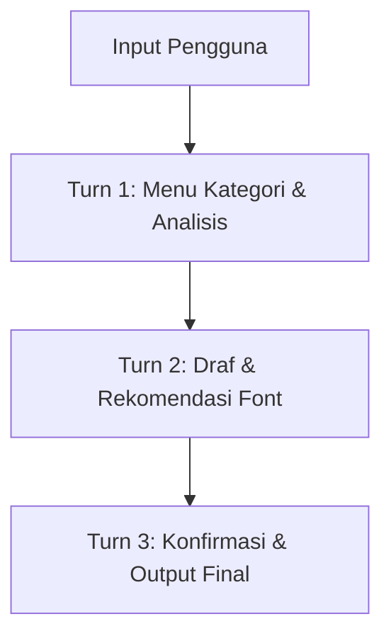

# 🎨 Cara Cepat Menggunakan Skill .LOGIC (`panduan-sampel-font`)

<p align="left">
  
  
  
</p>

---

🔗 **Sumber Repositori:**  
👉 [GitHub — `IR-0058/desain-font-terhadap-buatan-Intelijen`](https://github.com/IR-0058/desain-font-terhadap-buatan-Intelijen)

---

## 📥 Langkah 1 — Unduh Repositori

> [!TIP]
> **Petunjuk Cepat:** Anda hanya perlu mengunduh file ZIP sekali untuk mendapatkan seluruh instruksi dan daftar font.

1. Buka repositori GitHub melalui tautan di atas.
2. Klik tombol hijau **Code** $\rightarrow$ Pilih 📥 **Download ZIP**.
3. Ekstrak file ZIP di folder lokal komputer Anda.
4. Pastikan isi folder memuat struktur berikut:

```text
📦 desain-font-terhadap-buatan-Intelijen
 ┣ 📄 README.md
 ┗ 📂 panduan-sampel-font/
    ┣ 📜 1. SKILL.md             <-- (Instruksi Utama Skill)
    ┣ 📜 PLATFORM_SETUP.md        <-- (Panduan Lanjutan Platform)
    ┣ 📄 daftar_font.txt         <-- (Daftar & Spesifikasi Font)
    ┣ 📄 strukturnya.txt
    ┣ 🐍 auto_installer.py        <-- (Skrip Pemasangan Otomatis)
    ┗ 📂 adapters/                <-- (Khusus Claude, Gemini, Copilot, dll.)
```

---

## ⚙️ Langkah 2 — Panduan Pemasangan Spesifik per Platform

Pilih platform/aplikasi AI yang Anda gunakan di browser **Google Chrome** atau desktop:

### 🔵 1. Google Chrome — Gemini (`gemini.google.com`)

* **Metode A: Menggunakan Fitur Gems (Permanen)**
  1. Buka `gemini.google.com` di browser Google Chrome.
  2. Di panel sebelah kiri, klik **Gems Manager** (atau **Create Gem** / **Gem Builder**).
  3. Beri nama Gem, contoh: `Logic Font Assistant`.
  4. Buka berkas `1. SKILL.md` dengan Notepad/Text Editor, salin seluruh isinya, lalu tempelkan (*paste*) ke kolom **Instructions** di Gem.
  5. Klik **Save**. Sekarang Anda bisa memakai skill ini kapan saja lewat menu Gems.

* **Metode B: Melalui Chat Biasa / Side Panel Chrome**
  1. Buka chat Gemini di Google Chrome.
  2. Klik ikon 📎 **Lampirkan File** / **Upload File**.
  3. Unggah file `1. SKILL.md` dan `daftar_font.txt`.
  4. Ketik kebutuhan dokumen Anda di kolom chat.

---

### 🟢 2. ChatGPT (`chatgpt.com`)

* **Metode A: Menggunakan Custom GPT (Permanen untuk ChatGPT Plus/Team/Pro)**
  1. Buka `chatgpt.com` $\rightarrow$ Klik **Explore GPTs** $\rightarrow$ Klik **+ Create**.
  2. Masuk ke tab **Configure**.
  3. Masukkan nama: `Font & Layout Designer`.
  4. Scroll ke bawah ke bagian **Knowledge** $\rightarrow$ Klik **Upload files**.
  5. Unggah berkas `1. SKILL.md` dan `daftar_font.txt`.
  6. Klik **Save / Publish** (*Only me* / *Anyone with link*).

* **Metode B: Chat Biasa (ChatGPT Gratis)**
  1. Buka percakapan baru di ChatGPT.
  2. Klik ikon 📎 (**Plus/Attach**) $\rightarrow$ Unggah `1. SKILL.md`.
  3. Tuliskan permintaan dokumen Anda.

---

### 🟠 3. Anthropic Claude (`claude.ai`)

* **Metode A: Menggunakan Claude Projects (Rekomendasi)**
  1. Buka `claude.ai` $\rightarrow$ Klik menu **Projects** $\rightarrow$ **Create Project**.
  2. Beri nama proyek (misal: *Desain Dokumen & Font*).
  3. Di kolom **Project Knowledge**, klik **Add Content / Upload**.
  4. Unggah berkas `1. SKILL.md` dan `daftar_font.txt`.
  5. Mulai percakapan di dalam project tersebut.

* **Metode B: Claude Code / Terminal CLI**
  Salin folder `panduan-sampel-font/` ke direktori lokal:
  ```bash
  ~/.claude/skills/panduan-sampel-font/SKILL.md
  ```
  *Claude Code akan mendeteksi skill secara otomatis.*

---

### 🟣 4. Microsoft Copilot & Aplikasi AI Lainnya (Web / Desktop)

1. Buka browser atau aplikasi AI pilihan Anda (Microsoft Copilot, Perplexity, Poe, Ollama GUI, dll).
2. Lampirkan file `1. SKILL.md` pada pesan pertama sesi chat baru.
3. Atau buka file `1. SKILL.md`, salin teks instruksi utamanya, dan tempelkan sebagai *system prompt* / instruksi awal.

---

### 🐍 5. Pemasangan Otomatis (Skrip Python)

Jika Anda menggunakan lingkungan lokal/CLI:
1. Buka **Terminal** / **Command Prompt** di folder hasil ekstraksi ZIP.
2. Jalankan perintah:
   ```bash
   python panduan-sampel-font/auto_installer.py
   ```
   *Skrip akan memasang adapter secara otomatis ke sistem/AI lokal Anda.*

---

## 🚀 Langkah 3 — Cara Menggunakan Dalam Percakapan

> [!NOTE]
> Setelah skill terpasang di platform AI pilihan Anda, Anda **TIDAK PERLU** menjalankan prompt rumit untuk menggabungkan file. Cukup ketik langsung kebutuhan dokumen Anda!



### 💬 Contoh Prompt Siap Pakai:
* 🟢 `"Saya ingin membuat dokumen proposal bisnis formal untuk klien perbankan."`
* 🔵 `"Buatkan draf laporan penelitian ilmiah dengan format font yang sesuai."`
* 🔴 `"Saya butuh desain pamflet promosi produk UMKM makanan lokal."`

---

### 🔄 Penjelasan Alur Kerja (Turn 1 – Turn 3):

1. **Turn 1 — Menu Kategori:**
   AI menganalisis kebutuhan dokumen Anda dan menampilkan pilihan kategori beserta arah hierarki visual.
2. **Turn 2 — Rekomendasi Font & Draf Konten:**
   AI menyusun draf isi dokumen sekaligus memberikan rekomendasi kombinasi font (Latin / Non-Latin / Mandarin) yang presisi.
3. **Turn 3 — Konfirmasi & Finalisasi:**
   Anda mengonfirmasi pasangan font pilihan, lalu AI mengunci format serta memberikan panduan penataan spesifikasi cetak/digital lengkap.
