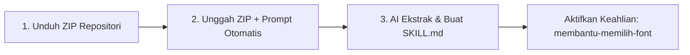

# ⚡ Cara Tercepat: ZIP Direct-to-Skill (`SKILL.md` / Keahlian Gemini)

🔗 **Sumber Repositori:**
👉 [GitHub — `IR-0058/desain-font-terhadap-buatan-Intelijen`](https://github.com/IR-0058/desain-font-terhadap-buatan-Intelijen)

---

## 🚀 Alur Otomatis 3 Langkah Kilat

> [!TIP]
> **Tujuan Utama:** 
> Ekstrak file ZIP $\rightarrow$ AI/LLM langsung menggabungkan seluruh instruksi $\rightarrow$ Langsung tersimpan sebagai **`SKILL.md`** atau Keahlian Gemini bernama **`membantu-memilih-font`**.



---

## 📥 Langkah 1 — Unduh Berkas ZIP

1. Buka repositori GitHub: [`IR-0058/desain-font-terhadap-buatan-Intelijen`](https://github.com/IR-0058/desain-font-terhadap-buatan-Intelijen).
2. Klik tombol hijau **Code** $\rightarrow$ Pilih 📥 **Download ZIP** (`desain-font-terhadap-buatan-Intelijen-master.zip`).
3. Simpan di perangkat Anda (tidak perlu diekstrak manual).

---

## 🤖 Langkah 2 — Unggah File ZIP & Perintahkan AI Ekstrak Langsung

Buka platform AI pilihan Anda (Gemini, ChatGPT, atau Claude), **lampirkan berkas `.zip`**, lalu tempelkan prompt perintah otomatis berikut:

```text
Ekstrak dan analisis seluruh isi repositori dalam ZIP ini (terutama folder panduan-sampel-font/, 1. SKILL.md, daftar_font.txt, spesifikasi_font.txt, skill_bantu.md, strukturnya.txt, dan folder adapters/).

TUGAS UTAMA AI:
Gabungkan seluruh instruksi, logika hierarki font, aturan alur Turn 1 -> Turn 2 -> Turn 3, daftar font, dan adapter platform menjadi SATU STRUKTUR UTUH SIAP PAKAI.

Keluaran Hasil Ekstraksi:
1. Simpan/formatkan hasil penggabungan utama sebagai file: `SKILL.md`
2. Jika dimasukkan ke dalam fitur Gemini Gems / Keahlian, aktifkan dan beri nama Keahlian ini: `membantu-memilih-font`

Aturan Output:
- Pertahankan struktur alur kerja Turn 1 -> Turn 2 -> Turn 3 secara presisi.
- JANGAN HAPUS atau merubah nomor/nama font dari daftar_font.txt.
- Buat format markdown utuh yang bersih agar langsung aktif sebagai System Instruction / Keahlian tanpa perlu pengeditan manual lagi.
```

---

## 💾 Langkah 3 — Simpan Menjadi `SKILL.md` & Keahlian `membantu-memilih-font`

Setelah AI selesai mengekstrak dan menyusun berkas instruksi utuh:

### 🌐 1. Google Gemini (Gems / Keahlian)
1. Buka **Gemini** $\rightarrow$ Klik **Gems / Keahlian** $\rightarrow$ **Buat Gem Baru**.
2. Beri nama Keahlian: **`membantu-memilih-font`**.
3. Tempelkan seluruh isi output hasil ekstraksi AI ke kolom **Instruksi (Instructions)**.
4. Klik **Simpan (Save)**. Keahlian kini aktif secara permanen!

### 🟢 2. Simpan Berkas Lokal (`SKILL.md`)
1. Salin output markdown dari AI dan simpan sebagai file bernama **`SKILL.md`**.
2. File ini siap dipakai untuk:
   * **Claude (Projects / Code CLI):** Unggah ke *Project Knowledge* atau taruh di `~/.claude/skills/membantu-memilih-font/SKILL.md`.
   * **ChatGPT (Custom GPTs):** Unggah `SKILL.md` ke bagian *Knowledge*.
   * **Cursor AI / Agentic LLM:** Masukkan `SKILL.md` ke aturan *system prompt* agent.

---

## 🎯 Langkah 4 — Mulai Menggunakan Keahlian

Setelah Keahlian **`membantu-memilih-font`** aktif, Anda tidak perlu melampirkan berkas lagi di chat baru. Cukup ketik dokumen yang ingin Anda buat!

> 💬 **Contoh Prompt Ke AI:**  
> *"Saya ingin membuat dokumen proposal bisnis formal untuk klien perbankan."*

### 🔄 Alur Otomatis AI (Turn 1 – Turn 3):
* **Turn 1 — Menu Kategori:** AI menganalisis kebutuhan dokumen Anda dan menampilkan pilihan menu kategori.
* **Turn 2 — Rekomendasi Font & Draf:** AI membuat draf isi dokumen sekaligus memberikan rekomendasi kombinasi font.
* **Turn 3 — Konfirmasi Final:** AI mengunci pasangan font pilihan Anda dan menyajikan spesifikasi dokumen lengkap.
