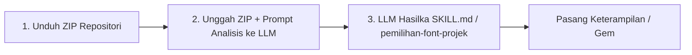

# ⚡ Cara Tercepat: ZIP ke `SKILL.md` Universal (Untuk LLM & Agentic AI)

🔗 **Sumber Repositori:**
👉 [GitHub — `IR-0058/desain-font-terhadap-buatan-Intelijen`](https://github.com/IR-0058/desain-font-terhadap-buatan-Intelijen)

## 🚀 Alur 3 Langkah Kilat (ZIP Direct-to-Skill)

> [!TIP]
> **Metode Ini Untuk Siapa?**
> Bagi Anda yang ingin membuat **SATU file `SKILL.md` universal** langsung dari file `.zip` repositori tanpa perlu ekstrak file satu per satu atau menyusun folder manual melalui LLM (seperti saya/Gemini, Claude, atau ChatGPT).



### Langkah 1 — Unduh File `.zip` Repositori

1. Buka repositori GitHub: [`IR-0058/desain-font-terhadap-buatan-Intelijen`](https://github.com/IR-0058/desain-font-terhadap-buatan-Intelijen).
2. Klik tombol hijau **Code** $\rightarrow$ Pilih 📥 **Download ZIP**.
3. Simpan file ZIP di perangkat Anda (tidak perlu diekstrak jika LLM yang Anda gunakan mendukung pembacaan berkas ZIP).

### Langkah 2 — Unggah File ZIP & Berikan Instruksi Analisis ke LLM

Buka platform LLM yang Anda gunakan (seperti percakapan dengan saya di Google Chrome, Gemini Advanced, Claude, atau ChatGPT), **lampirkan/unggah file `desain-font-terhadap-buatan-Intelijen-master.zip`**, lalu salin-tempel (*copy-paste*) prompt master di bawah ini:

```text
Ekstrak dan analisis seluruh isi repositori dalam ZIP ini (terutama folder panduan-sampel-font/, 1. SKILL.md, daftar_font.txt, spesifikasi_font.txt, skill_bantu.md, strukturnya.txt, dan folder adapters/).

Tugas Utama Anda (LLM):
Gabungkan seluruh instruksi, logic hirarki font, aturan Turn 1-3, daftar font, dan penyesuaian adapter platform menjadi SATU FILE MARKDOWN UTUH bernama `SKILL.md` (atau jika Gemini memakai keahlian, beri nama `pemilihan-font-projek` / `pemetaan-nama-Font`).

Aturan Output SKILL.md / pemilihan-font-projek:
1. Harus kompatibel sebagai System Instruction / Custom Skill / Knowledge File / Gem Instruction untuk SEMUA jenis LLM dan Agentic AI (Gemini Gems/Keahlian, Claude Projects/Code, Custom GPTs, Cursor, Windsurf, LangChain/LlamaIndex agents).
2. Pertahankan seluruh struktur alur kerja Turn 1 -> Turn 2 -> Turn 3.
3. Jangan hapus, singkat, atau ubah nomor/nama font yang ada dalam daftar_font.txt.
4. Buat format markdown yang sangat bersih, terstruktur, dan langsung siap dipakai sebagai prompt sistem/keterampilan tanpa perlu koreksi lanjutan.

Keluarkan hasil akhir HANYA sebagai satu blok kode Markdown utuh siap salin.
```

### Langkah 3 — Simpan & Pasang Keterampilan ke LLM Pilihan Anda

Setelah LLM memproses dan menghasilkan keluaran Markdown utuh:

1. Salin teks tersebut dan simpan di komputer Anda sebagai berkas **`SKILL.md`** (atau jika menggunakan Gemini Keahlian/Gems, beri nama Gem/perkas sebagai **`pemilihan-font-projek`** atau `pemetaan-nama-Font`).
2. Pasang file `SKILL.md` atau `pemilihan-font-projek` sesuai platform LLM yang Anda gunakan:

#### 🌐 1. Google Chrome — Gemini (Saya / Gemini Web & Side Panel)

* **Memakai Gems / Keahlian (Permanen):**
  Buka `gemini.google.com` $\rightarrow$ **Gems Manager / Keahlian** $\rightarrow$ **Create Gem** $\rightarrow$ Beri nama **`pemilihan-font-projek`** (atau `pemetaan-nama-Font` / `Logic Font Assistant`) $\rightarrow$ Tempel isi `SKILL.md` / `pemilihan-font-projek` ke kolom **Instructions / Instruksi** $\rightarrow$ **Save**.

* **Chat Sesi Biasa:**
  Lampirkan file `SKILL.md` atau `pemilihan-font-projek.md` langsung di kolom chat awal saat memulai percakapan baru dengan saya.

#### 🟢 2. OpenAI ChatGPT

* **Custom GPT (Plus/Team/Pro):**
  Buka `chatgpt.com` $\rightarrow$ **Explore GPTs** $\rightarrow$ **Create** $\rightarrow$ Tab **Configure** $\rightarrow$ Unggah `SKILL.md` ke bagian **Knowledge**.

* **ChatGPT Gratis:**
  Unggah/lampirkan file `SKILL.md` pada pesan pertama percakapan.

#### 🟠 3. Anthropic Claude (Web & Agentic CLI)

* **Claude Projects:**
  Buka `claude.ai` $\rightarrow$ **Projects** $\rightarrow$ **Create Project** $\rightarrow$ Unggah `SKILL.md` ke **Project Knowledge**.

* **Claude Code / CLI Agent:**
  Simpan di direktori lokal: `~/.claude/skills/font-logic/SKILL.md`.

#### 💻 4. Agentic AI & IDE (Cursor / Roo Code / AutoGPT / CrewAI / LangChain)

* Tempelkan isi `SKILL.md` ke dalam file `.cursorrules`, `system_prompt.txt`, atau bagian `Instructions / Rules` pada agent framework yang Anda bangun.

---

## 🎯 Cara Memakai (Setelah Skill / Keahlian Terpasang di LLM)

Di percakapan baru, Anda **tidak perlu** mengunggah berkas lagi. Cukup ketik dokumen yang ingin Anda buat!

> 💬 **Contoh Prompt Ke LLM:**
>
> *"Buatkan proposal penawaran proyek sistem informasi untuk instansi pemerintah."*

### Alur Otomatis yang Dijalankan oleh LLM:

1. **Turn 1 (Menu Kategori):** LLM mengidentifikasi jenis dokumen dan menampilkan menu kategori & aturan visual.
2. **Turn 2 (Draf & Font):** LLM menyusun isi dokumen sekaligus memberikan rekomendasi kombinasi font secara spesifik.
3. **Turn 3 (Finalisasi):** LLM mengunci pilihan font dan menyajikan format final siap cetak/terbit.
