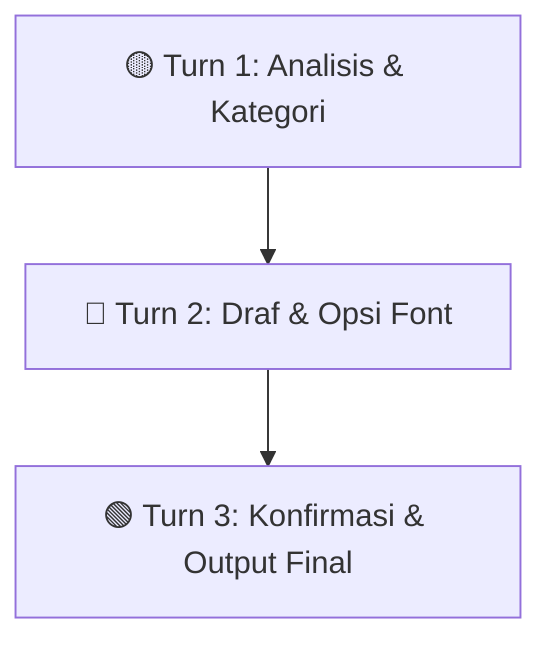

# 🎨 Cara Cepat Menggunakan Skill .LOGIC (`panduan-sampel-font`)

<p align="left">
  
  
  
</p>

---

🔗 **Sumber Repositori:**  
👉 [GitHub — `IR-0058/desain-font-terhadap-buatan-Intelijen`](https://github.com/IR-0058/desain-font-terhadap-buatan-Intelijen)

---

## 📥 Langkah 1 — Unduh Repositori

> [!TIP]
> **Petunjuk Cepat:** Anda hanya perlu mengunduh file ZIP sekali untuk mendapatkan seluruh instruksi dan daftar font.

1. Buka repositori GitHub melalui tautan di atas.
2. Klik tombol hijau **`Code`** $\rightarrow$ Pilih 📥 **`Download ZIP`**.
3. Ekstrak file ZIP di perangkat Anda.
4. Pastikan struktur berkas di dalam folder memuat:

```text
📦 desain-font-terhadap-buatan-Intelijen
 ┣ 📄 README.md
 ┗ 📂 panduan-sampel-font/
    ┣ 📜 1. SKILL.md             <-- (Instruksi Utama Skill)
    ┣ 📜 PLATFORM_SETUP.md        <-- (Panduan Lanjutan)
    ┣ 📄 daftar_font.txt         <-- (Basis Data Font)
    ┣ 📄 strukturnya.txt
    ┣ 🐍 auto_installer.py        <-- (Skrip Pemasangan Otomatis)
    ┗ 📂 adapters/                <-- (Khusus Claude, Gemini, Copilot, dll.)
```

---

## ⚙️ Langkah 2 — Pemasangan Sesuai Platform AI

Pilih metode di bawah ini sesuai dengan platform AI yang Anda gunakan:

| Platform AI | Status | 🛠️ Cara Memasang / Memuat |
| :--- | :---: | :--- |
|  | `Recommended` | Buat **Project** baru $\rightarrow$ Buka **Project Knowledge** $\rightarrow$ Unggah `1. SKILL.md` & `daftar_font.txt`. |
|  | `Advanced` | Salin folder `panduan-sampel-font/` ke direktori lokal `~/.claude/skills/panduan-sampel-font/SKILL.md`. |
|  | `Popular` | Pilih **Explore GPTs** $\rightarrow$ **Create** $\rightarrow$ Di tab **Configure**, unggah `1. SKILL.md` & `daftar_font.txt` ke bagian **Knowledge**. |
|  | `Easy` | Buat **Gem** baru $\rightarrow$ Salin seluruh isi file `1. SKILL.md`, lalu tempelkan (*paste*) ke kolom **Instructions**. |
|  | `Auto` | Jalankan `python auto_installer.py` di terminal lokal Anda untuk memasang adapter secara otomatis. |
|  | `Quick` | Lampirkan file `1. SKILL.md` (dan `daftar_font.txt`) langsung di kolom percakapan saat membuka chat baru. |

---

## 🚀 Langkah 3 — Cara Menggunakan Dalam Percakapan

> [!NOTE]
> Setelah skill terpasang, Anda **TIDAK PERLU** memasukkan prompt penggabungan file. Cukup ketik langsung kebutuhan dokumen Anda!

### 💬 Contoh Prompt Siap Pakai:

> 🟢 *"Saya ingin membuat dokumen proposal bisnis formal untuk klien perbankan."*  
> 🔵 *"Buatkan draf laporan penelitian ilmiah dengan format font yang sesuai."*

---

### 🔄 Alur Kerja Otomatis AI (`Turn 1` – `Turn 3`):



1. <mark><b>Turn 1 — Menu Kategori:</b></mark>  
   AI menganalisis kebutuhan dokumen Anda dan menampilkan pilihan kategori beserta arah desain awal.

2. <mark><b>Turn 2 — Rekomendasi Font & Draf:</b></mark>  
   AI membuat draf isi dokumen sekaligus memberikan rekomendasi kombinasi font (Latin / Non-Latin / Mandarin) yang estetis dan berhierarki.

3. <mark><b>Turn 3 — Konfirmasi & Finalisasi:</b></mark>  
   Anda memilih pasangan font yang diinginkan, lalu AI mengunci format serta memberikan rincian teknis penataan dokumen.
